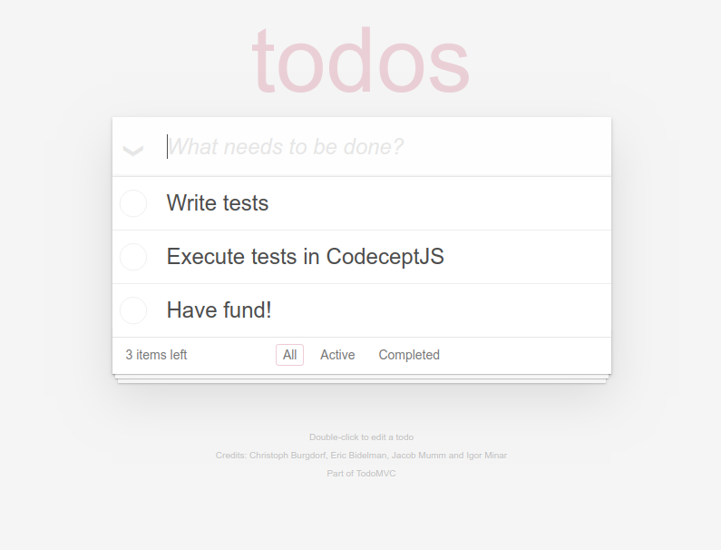

This repo contains tests for TodoMVC application.
Tests can be executed via different helpers.



# Installation

This is a playground for your first steps in testing, so instead of installing it from NPM it is recommended to clone it from repo instead and then install the dependencies:

```
git clone git@github.com:codeceptjs/examples.git codeceptjs-examples && cd codeceptjs-examples && npm i
```

This will install CodeceptJS 4.x with Playwright, Puppeteer & WebdriverIO packages.

# Running Tests

The default helper is Playwright.

## Playwright

Use `codecept.conf.js` to run tests with Playwright:

```
npx codeceptjs run --steps
```

## Puppeteer

Use `codecept.puppeteer.conf.js` to run tests with Puppeteer:

```
npx codeceptjs run --steps -c codecept.puppeteer.conf.js
```

## WebdriverIO

Use `codecept.webdriver.conf.js` to run tests with WebdriverIO in Chrome:

```
npx codeceptjs run -c codecept.webdriver.conf.js --steps
```

## Alternative browsers

CodeceptJS 4.x can drive lightweight alternative browsers over the Chrome DevTools Protocol.
They are much faster and smaller than Chrome, at the cost of some features — pick the one that fits your suite:

| Helper | Browser | Renders screenshots | JavaScript | Best for |
| --- | --- | --- | --- | --- |
| `Playwright` / `Puppeteer` / `WebDriver` | Chrome/Chromium | ✅ | ✅ V8 | everything, full compatibility |
| `Obscura` | [Obscura](https://github.com/h4ckf0r0day/obscura) | ✅ | ✅ | fast smoke tests with screenshots |
| `Lightpanda` | [Lightpanda](https://lightpanda.io) | ❌ | ✅ V8 | fastest smoke tests, CI-friendly |
| `Moli` | [Moli](https://github.com/lexmount/moli) | ❌ | ✅ V8 + Servo styles | fast smoke tests, real CSS |

**Known limitations on this TodoMVC (React) app:**

- Alternative browsers use synthetic input: React checkbox toggling (`checkOption`) and hover-revealed controls (delete buttons appear on hover) may not work. Such tests are tagged `@full-browser` and excluded from the alternative-browser configs via `grep` — copy that pattern to your own suite.
- No screenshots on Lightpanda/Moli: `I.saveScreenshot()` is a no-op (a debug message is printed).
- Lightpanda has no Windows binary yet — on Windows run it via WSL or Docker and point the helper at the running server (`endpoint` config option). Moli ships Windows builds.

### Obscura

Install the [Obscura binary](https://github.com/h4ckf0r0day/obscura/releases) and run:

```
OBSCURA_PATH=/path/to/obscura npx codeceptjs run --steps -c codecept.obscura.conf.js
```

### Lightpanda

Install [Lightpanda](https://lightpanda.io/docs/open-source/installation) and run:

```
LIGHTPANDA_PATH=/path/to/lightpanda npx codeceptjs run --steps -c codecept.lightpanda.conf.js
```

### Moli

Install [Moli](https://github.com/lexmount/moli#direct-installation) and run:

```
MOLI_PATH=/path/to/moli npx codeceptjs run --steps -c codecept.moli.conf.js
```

The Moli helper ships with CodeceptJS versions after 4.2.1.

## Headless Mode

Run tests in headless mode:

```
HEADLESS=true npx codeceptjs run --steps
```

## Parallel Execution

Run tests in parallel with 3 workers:

```
npx codeceptjs run-workers 3
```

## Credits

Created as part of codepress by Stefan Huber.
Maintained by CodeceptJS Team.

## LICENSE

MIT
